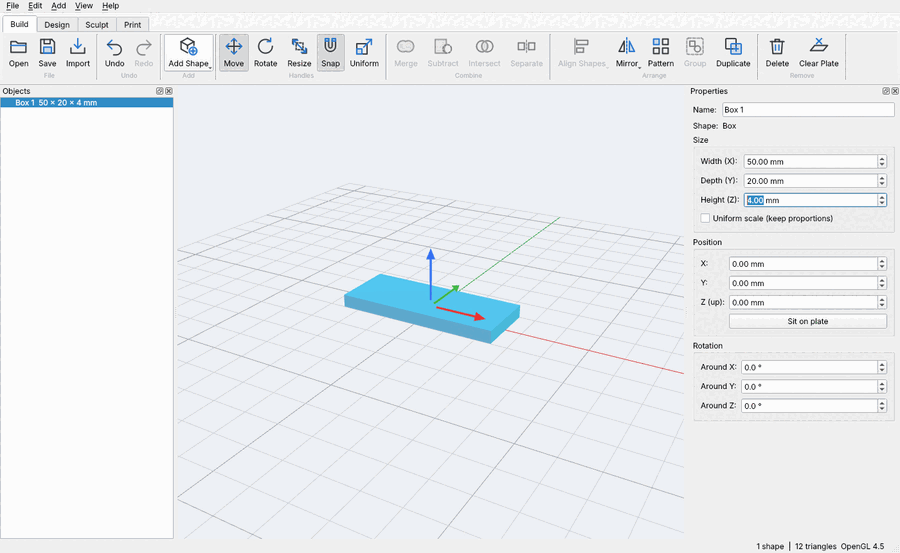
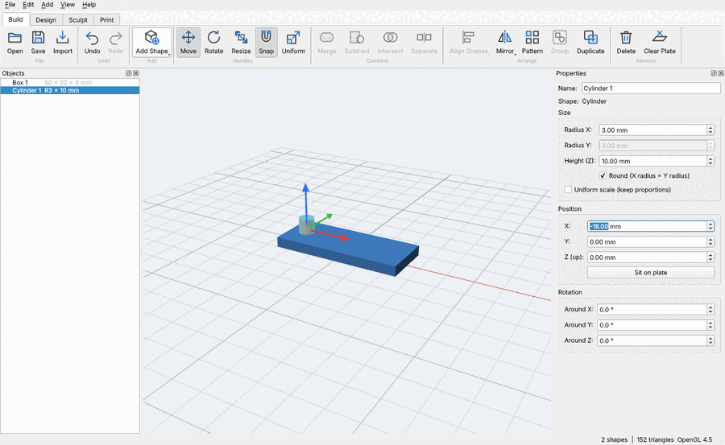
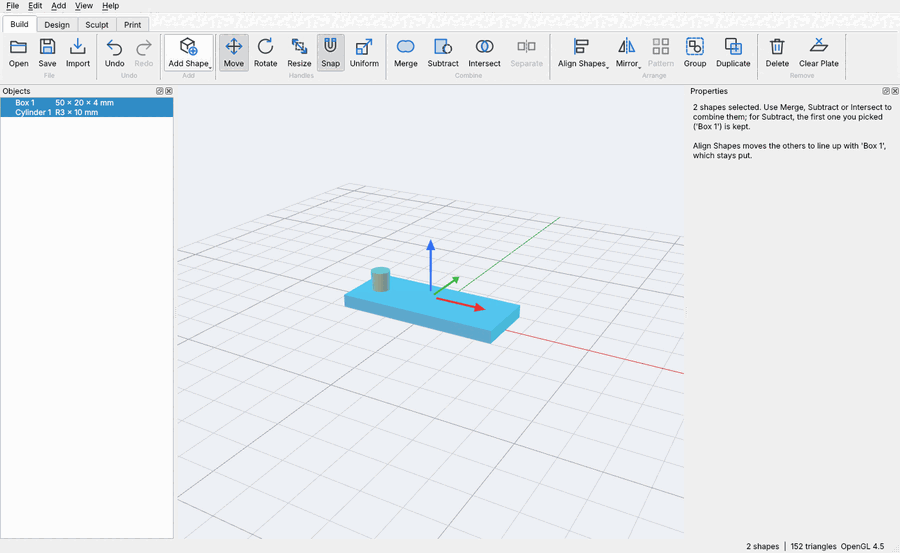
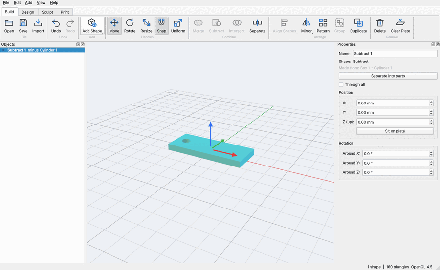
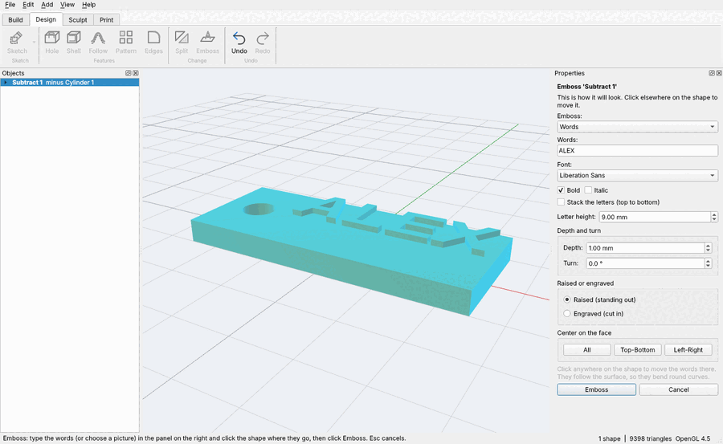
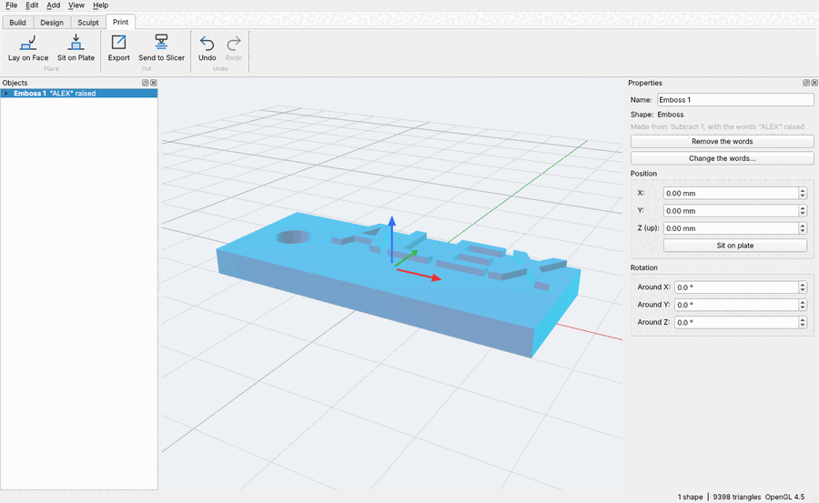

# Quick Start: your first print

In about ten minutes you'll make a key tag with a hole for the ring and your name standing out on top, then send it to your printer. Every number is in millimetres.

## Getting round the view

- **Turn the view:** drag with the right mouse button
- **Slide the view:** drag with the middle button (or Shift + right button)
- **Zoom:** the mouse wheel
- **Fit everything in view:** F (Home puts the view back to the start)

## 1. Add a box and size it

**Build → Add Shape → Box**. In **Properties** on the right, type **Width 50**, **Depth 20** and **Height 4**, pressing Enter after each.

## 2. Add the shape for the hole

**Add Shape → Cylinder**. Make it **Radius 3** and **Height 10**, then set its **X** to **-18** so it stands up through the left end of the tag.

## 3. Pick both, the tag first

Click **Box 1** in **Objects** on the left, then hold **Ctrl** and click **Cylinder 1**. Subtract keeps the first shape you pick and cuts the others out of it.

## 4. Cut the hole

Click **Subtract**. The cylinder cuts its hole and disappears. Nothing is lost: double-click a step in **Objects** any time to change it, and the tag follows.

## 5. Put your name on it

**Design → Emboss**. Type your name, set **Letter height 9** and **Depth 1**, keep **Raised**, click the top of the tag where the words should go, then click **Emboss**.

## 6. Print it

**Print → Export** saves an STL or 3MF file your slicer opens. **Send to Slicer** opens it in your slicer straight away (the first time, it asks which slicer you use). If a shape needs a different face down, **Lay on Face** and click that face.

## 7. Keep your work

**File → Save** keeps a `.f3d` file with every step, so you can open it later and change the name, the hole or the size.

## Good to know

- **Ctrl+Z** undoes anything; **Esc** cancels the tool you're in.
- Point at any button for a tip about what it does.
- **Help → Take the Tour** shows where everything is; this guide is in **Help → Quick Start Guide**.
- Made a mistake with the order in step 3? Undo, and pick them again the other way round.
